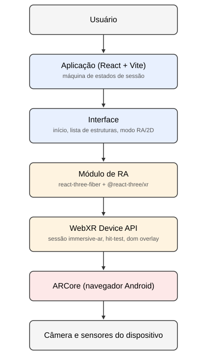
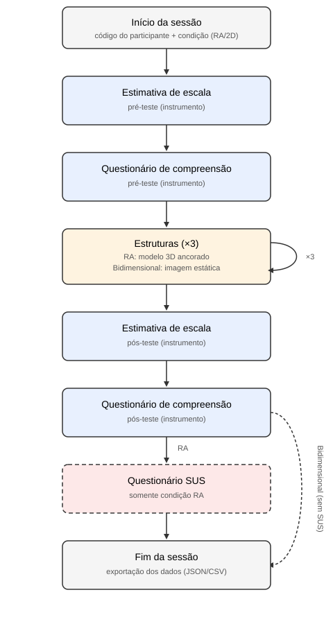

# Realidade Aumentada para Monumentos Histórico-Culturais

> Aplicação móvel de realidade aumentada que representa a escala e o processo construtivo do Coliseu, da Estátua da Liberdade e do Cristo Redentor, comparando seu efeito na compreensão desses aspectos com o de representações bidimensionais.


---

## 1. Identificação do Projeto

| Item            | Informação                                              |
| --------------- | ------------------------------------------------------- |
| **Projeto**     | Realidade Aumentada para Monumentos Histórico-Culturais |
| **Equipe**      | Conect Way                                              |
| **Curso**       | Engenharia de Computação                                |
| **Disciplina**  | UPx08 - Realidade Aumentada                             |
| **Professor**   | Daniel Ohata                                            |
| **Instituição** | Centro Universitário Facens, Sorocaba, SP               |
| **Semestre**    | 8º semestre, 2026                                       |

### Integrantes

| Nome                           | RA     | Responsabilidade técnica                                                                              |
| ------------------------------ | ------ | ----------------------------------------------------------------------------------------------------- |
| Bruno da Silveira Escanhoela   | 236793 | Pesquisa, licenciamento e otimização dos modelos 3D, validação de campo do rastreamento WebXR         |
| Gabriel Ferreira do Nascimento | 236085 | Configuração do projeto, implementação da ancoragem e do ajuste de escala do modelo, deploy na Vercel |
| João Guilherme Volta Kinol     | 235255 | Implementação dos instrumentos de avaliação (questionário SUS e questionário de compreensão)          |

---

## 2. Visão Geral

Recursos didáticos bidimensionais, como fotografias e ilustrações de livro didático, são amplamente utilizados no ensino de História, mas frequentemente falham em transmitir a magnitude física e a complexidade temporal de grandes monumentos histórico-culturais. Dados como altura e tempo de construção chegam ao estudante como números abstratos, sem referência corporal ou noção de esforço coletivo.

O público afetado por esse problema são estudantes do Ensino Fundamental, ao longo de diferentes anos do componente curricular de História, no estudo do patrimônio material como registro de sociedades passadas.

A solução proposta é uma aplicação móvel de realidade aumentada que posiciona modelos tridimensionais do Coliseu, da Estátua da Liberdade e do Cristo Redentor no ambiente físico do usuário, em escala reduzida (modo maquete), e apresenta o processo construtivo de cada estrutura como uma sequência de etapas navegáveis. A mesma aplicação também disponibiliza um modo bidimensional equivalente, usado como grupo de controle num estudo comparativo que avalia o efeito da representação em RA sobre a compreensão de escala e de processo construtivo.

A Realidade Aumentada participa da solução na camada central da aplicação: por meio da WebXR Device API, com detecção de superfícies (hit-test), o modelo tridimensional é ancorado sobre o ambiente capturado pela câmera do dispositivo, permitindo que o usuário o observe de diferentes posições e distâncias, ao contrário do que uma foto ou ilustração estática permite.

---

## 3. Problema

O ensino de patrimônio cultural material, ao tratar de monumentos históricos de grande porte, depende tradicionalmente de fotografias, ilustrações de livro didático e vídeos. Esses recursos comunicam bem a forma desses monumentos, mas dificilmente comunicam sua real magnitude: as dimensões físicas e a duração das obras chegam ao estudante como números abstratos, sem referência corporal nem noção do esforço coletivo envolvido em sua construção.

Essa dificuldade afeta estudantes do Ensino Fundamental brasileiro, no contexto do estudo de patrimônio cultural previsto na Base Nacional Comum Curricular. Sem uma forma de situar o monumento no próprio espaço do observador, o estudante tende a tratar sua escala e seu processo construtivo como fatos a memorizar, não como algo que pode ser compreendido espacialmente.

Esse problema existe porque nenhuma das soluções tradicionais isola o efeito da representação tridimensional sobre essa compreensão: a literatura da área trata a escala principalmente como restrição técnica, não como aspecto a ser diretamente comparado e medido.

---

## 4. Objetivos

### 4.1 Objetivo Geral

Desenvolver uma aplicação móvel de realidade aumentada que represente a escala e o processo construtivo de monumentos histórico-culturais, permitindo comparar seu efeito na compreensão desses aspectos com o de representações bidimensionais equivalentes.

### 4.2 Objetivos Técnicos

- implementar a ancoragem de modelos tridimensionais no ambiente físico via WebXR hit-test;
- permitir o ajuste da escala do modelo ancorado, em modo maquete, entre 1 e 4 metros;
- apresentar o processo construtivo de cada monumento como uma sequência de etapas navegáveis;
- implementar um modo bidimensional equivalente, destinado ao grupo de controle;
- implementar os instrumentos de avaliação (estimativa de dimensões, ordenação das etapas, questionário de compreensão e questionário de usabilidade SUS);
- disponibilizar a aplicação via navegador, acessível por HTTPS, sem necessidade de instalação;
- registrar e exportar os dados coletados em formato JSON e CSV.

---

## 5. Público-Alvo

O público-alvo descrito na pesquisa que motiva o projeto é o de estudantes do Ensino Fundamental, no contexto do ensino de patrimônio cultural material. Esse público não exige familiaridade técnica prévia: a aplicação foi pensada para rodar em smartphones Android comuns, sem necessidade de instalar nenhum aplicativo além do navegador.

Nesta etapa do projeto, por restrição de escopo (ausência de aprovação ética e de acesso formal a instituições de ensino básico), os testes e validações do protótipo são conduzidos com usuários proxy: colegas de curso recrutados por conveniência, não pertencentes à população-alvo original. Essa limitação está detalhada na seção 24 (Limitações Conhecidas).

---

## 6. Funcionalidades

| ID   | Funcionalidade                      | Descrição                                                                                                                          | Status |
| ---- | ----------------------------------- | ---------------------------------------------------------------------------------------------------------------------------------- | ------ |
| RF01 | Ancorar o modelo tridimensional     | Ancora o modelo da estrutura selecionada sobre um plano detectado no ambiente físico, via WebXR hit-test, em modo maquete          | ✅     |
| RF02 | Ajustar o tamanho do modelo         | Permite ajustar o tamanho do modelo ancorado entre 1 e 4 metros no maior eixo, calculado a partir da altura real de cada estrutura | ✅     |
| RF03 | Apresentar a estrutura da vez       | Apresenta cada estrutura (Coliseu, Estátua da Liberdade, Cristo Redentor) na ordem contrabalanceada definida pelo sistema          | ✅     |
| RF04 | Navegar pelas etapas construtivas   | Permite avançar e retroceder entre as etapas do processo construtivo, mantendo o modelo ancorado                                   | ❌     |
| RF05 | Exibir overlay informativo          | Exibe painel com texto e imagens de referência sobre a etapa construtiva em exibição                                               | ❌     |
| RF06 | Apresentar modo bidimensional       | Apresenta, ao grupo de controle, o mesmo conteúdo em formato de imagem plana, sem o modelo 3D                                      | ✅     |
| RF07 | Aplicar tarefa de estimativa        | Coleta a estimativa de dimensões e proporções de cada estrutura, antes e depois do uso                                             | ✅     |
| RF08 | Aplicar tarefa de ordenação         | Apresenta as etapas construtivas embaralhadas para o participante reordenar                                                        | ❌     |
| RF09 | Aplicar questionário de compreensão | Questionário de compreensão sobre o processo construtivo, em formato pré-teste e pós-teste                                         | ✅     |
| RF10 | Aplicar questionário SUS            | Questionário de usabilidade (SUS), aplicado apenas ao grupo experimental                                                           | ✅     |
| RF11 | Registrar e exportar dados          | Registra as respostas e interações da sessão, exportando em JSON e CSV                                                             | ✅     |
| RF12 | Exibir figura humana de referência  | Exibe uma figura humana em escala real (1,70 m) ao lado do modelo ancorado, como referência visual de tamanho                      | ✅     |

**Legenda:** ✅ Implementado · 🚧 Em desenvolvimento · ⬜ Planejado · ❌ Cancelado

> RF04, RF05 e RF08 foram cancelados: a equipe removeu a navegação por etapas construtivas do escopo do protótipo e do artigo (ver seção 24). RF09 e RF10 estão conectados ao fluxo principal da aplicação (`app/public/instrumentos/compreensao/` e `app/public/instrumentos/sus/`, abertos e retomados automaticamente pela máquina de estados de sessão em `session.ts`).

---

## 7. Requisitos Não Funcionais

| ID    | Categoria              | Requisito                                                                                                                     |
| ----- | ---------------------- | ----------------------------------------------------------------------------------------------------------------------------- |
| RNF01 | Plataforma             | A aplicação deve ser executada em navegador Android com suporte à WebXR Device API e ao ARCore, sem necessidade de instalação |
| RNF02 | Estabilidade           | O modelo ancorado deve permanecer fixo no plano detectado, sem deslocamento perceptível durante a sessão                      |
| RNF03 | Fidelidade dimensional | Os modelos devem preservar as proporções reais entre si em qualquer tamanho ajustado                                          |
| RNF04 | Desempenho             | Taxa mínima de 30 quadros por segundo e carregamento de cada modelo em até 10 segundos                                        |
| RNF05 | Ambiente               | Sessões em ambiente interno, com iluminação artificial uniforme e superfície horizontal texturizada                           |
| RNF06 | Usabilidade            | Usabilidade avaliada via System Usability Scale (SUS), com referência de 68 pontos                                            |
| RNF07 | Equivalência           | Os modos de RA e bidimensional devem rodar na mesma aplicação e dispositivo, com o mesmo conteúdo e tempo de exposição        |
| RNF08 | Disponibilidade        | Aplicação acessível via URL com HTTPS; dados armazenados localmente até a exportação                                          |
| RNF09 | Privacidade            | Participantes identificados apenas por código, sem dado pessoal identificável registrado                                      |

---

## 8. Tecnologias Utilizadas

| Tecnologia                                      | Versão  | Utilização                                                        |
| ----------------------------------------------- | ------- | ----------------------------------------------------------------- |
| React                                           | 19.2.8  | Biblioteca de interface                                           |
| react-three-fiber                               | 9.8.1   | Renderização 3D declarativa sobre Three.js                        |
| Three.js                                        | 0.186.1 | Motor de renderização 3D/WebGL                                    |
| @react-three/xr                                 | 6.6.31  | Integração com a WebXR Device API (hit-test, sessão immersive-ar) |
| @react-three/drei                               | 10.7.9  | Utilitários para react-three-fiber (carregamento de modelos glTF) |
| Tailwind CSS                                    | 4.3.3   | Estilização da interface                                          |
| Vite                                            | 6.4.3   | Build tool e servidor de desenvolvimento                          |
| TypeScript                                      | 6.0.2   | Tipagem estática                                                  |
| oxlint                                          | 1.81.0  | Linter                                                            |
| @gltf-transform (cli/core/extensions/functions) | 4.5.1   | Otimização dos modelos glTF (redução de polígonos)                |
| meshoptimizer                                   | 1.1.1   | Compressão de geometria dos modelos                               |
| sharp                                           | 0.35.5  | Compressão das texturas dos modelos                               |
| Vercel                                          | -       | Hospedagem e deploy contínuo, com HTTPS                           |
| GitHub                                          | -       | Controle de versão e hospedagem do repositório                    |

---

## 9. Hardware Utilizado

| Equipamento | Modelo             | Característica relevante                             | Utilização                                                |
| ----------- | ------------------ | ---------------------------------------------------- | --------------------------------------------------------- |
| Smartphone  | Samsung Galaxy S25 | Android, suporte à WebXR Device API e ao ARCore      | Validação completa em RA real                             |
| Computador  | Windows e Linux    | Google Chrome, com a extensão Immersive Web Emulator | Desenvolvimento e testes de interface, sem sessão RA real |

---

## 10. Arquitetura do Sistema



---

## 11. Funcionamento da Realidade Aumentada

A abordagem utilizada é markerless, por detecção de superfície (plane detection), via WebXR hit-test. Não há marcador, imagem de referência ou QR Code: o sistema reconhece qualquer plano horizontal detectado no ambiente capturado pela câmera.

Fluxo técnico:

Usuário escolhe a condição RA na tela de início → usuário toca em "Entrar em AR" → o navegador abre uma sessão WebXR `immersive-ar`, solicitando acesso à câmera → a cada quadro, `useXRHitTest` consulta o ARCore por planos detectados na direção em que o dispositivo aponta (`viewer`) → quando há um plano, um retículo (`Reticle`) é desenhado na posição detectada → o usuário toca na tela (evento `select` da sessão XR) → a posição do retículo no momento do toque é fixada como ponto de ancoragem → o modelo glTF da estrutura (via `useGLTF`) é instanciado nessa posição, em escala reduzida (modo maquete) → o usuário ajusta o tamanho pelo controle deslizante, renderizado como um `XRDomOverlay` sobre a cena → o usuário conclui a estrutura e o fluxo avança para a próxima.

---

## 12. Estrutura do Projeto

```
app/
├── public/
│   ├── models/          glBs otimizados (coliseu, estátua, cristo, humano)
│   └── instrumentos/    questionário SUS, questionário de compreensão e tarefa de estimativa
│   └── flat/             imagens estáticas do modo bidimensional, geradas via `npm run flat`
├── scripts/
│   ├── optimize-models.mjs   script de otimização dos modelos 3D
│   └── render-flat.mjs       gera as imagens do modo bidimensional a partir dos GLB da RA
├── src/
│   ├── App.tsx           telas e componentes de UI (início, lista, RA, 2D, instrumentos)
│   ├── session.ts        máquina de estados da sessão, persistência e exportação dos dados
│   ├── structures.tsx     dados e componentes dos modelos 3D
│   ├── counterbalance.ts  ordem contrabalanceada das estruturas por sessão
│   ├── main.tsx           ponto de entrada da aplicação
│   └── index.css          estilos globais (Tailwind)
docs/
├── documents/             documentação de licenças, otimização dos modelos e material 2D
└── diagrams/              diagramas do projeto (arquitetura)
README.md                  esta documentação
```

Os instrumentos em `app/public/instrumentos/` são publicados junto com o app e já estão conectados ao fluxo principal em `app/src` (ver seção 6, RF09-RF11): a máquina de estados em `session.ts` abre cada instrumento na mesma aba e confere o registro gravado antes de avançar.

---

## 13. Principais Scripts ou Componentes

| Arquivo               | Responsabilidade                                                                                                     |
| --------------------- | -------------------------------------------------------------------------------------------------------------------- |
| `App.tsx`             | Telas e componentes de UI (início, lista de estruturas, modo RA, modo 2D, instrumentos, conclusão)                   |
| `session.ts`          | Máquina de estados da sessão (etapas, instrumentos), persistência entre recarregamentos e exportação JSON/CSV (RF11) |
| `structures.tsx`      | Dados (dimensões reais) e componentes de carregamento dos modelos 3D (`Structure`, `HumanFigure`)                    |
| `counterbalance.ts`   | Define a ordem contrabalanceada das estruturas, cíclica por sessão via `localStorage`                                |
| `main.tsx`            | Ponto de entrada da aplicação React                                                                                  |
| `optimize-models.mjs` | Script Node, fora do app, usado pra reduzir polígonos e comprimir texturas dos modelos glTF                          |
| `render-flat.mjs`     | Script Node, fora do app, gera as imagens estáticas do modo bidimensional a partir dos GLB da RA                     |

Dentro de `App.tsx`, os componentes internos mais relevantes:

| Componente         | Responsabilidade                                                                                |
| ------------------ | ----------------------------------------------------------------------------------------------- |
| `StartScreen`      | Captura o código do participante e a condição experimental (RA ou Bidimensional)                |
| `StructureList`    | Mostra a estrutura da vez, na ordem contrabalanceada                                            |
| `InstrumentScreen` | Tela de transição para abrir um instrumento de avaliação (estimativa, compreensão ou SUS)       |
| `Reticle`          | Desenha o indicador de plano detectado via WebXR hit-test                                       |
| `AnchoredModel`    | Renderiza a estrutura e a figura humana de referência na posição ancorada                       |
| `SizeControl`      | Controle deslizante de tamanho do modelo, renderizado como `XRDomOverlay`                       |
| `FlatView`         | Tela do modo bidimensional, com a imagem estática real da estrutura (gerada via `npm run flat`) |
| `FpsMeter`         | Mede a taxa de quadros por segundo (ativado via `?fps` na URL, suporte ao RNF04)                |

---

## 14. Dependências

```
react ^19.2.8
react-dom ^19.2.8
@react-three/fiber ^9.8.1
@react-three/xr ^6.6.31
@react-three/drei ^10.7.9
three ^0.186.1
tailwindcss ^4.3.3
@tailwindcss/vite ^4.3.3
@gltf-transform/cli 4.5.1
@gltf-transform/core 4.5.1
@gltf-transform/extensions 4.5.1
@gltf-transform/functions 4.5.1
meshoptimizer 1.1.1
sharp 0.35.5
vite ^6.4.3
typescript ~6.0.2
oxlint ^1.81.0
```

Todas disponíveis via npm, listadas em `app/package.json`.

---

## 15. Configuração do Ambiente

1. Instalar o [Node.js](https://nodejs.org/) (testado com a versão 22).
2. Clonar o repositório.
3. Entrar na pasta `app/`.
4. Instalar as dependências com `npm install`.

Nenhuma variável de ambiente é necessária: o projeto não usa chave de API nem backend próprio.

---

## 16. Como Executar o Projeto

Dentro da pasta `app/`:

```
npm run dev
```

Inicia o servidor de desenvolvimento (Vite). Abre o endereço mostrado no terminal em um navegador com suporte à WebXR Device API (Chrome no Android, ou Chrome/Edge no desktop com a extensão Immersive Web Emulator para simular uma sessão AR).

```
npm run build
```

Gera a build de produção em `app/dist`, com verificação de tipos (`tsc -b`) antes do build.

```
npm run lint
```

Executa o linter (`oxlint`) sobre o código fonte.

```
npm run models
```

Roda o script de otimização dos modelos 3D (`scripts/optimize-models.mjs`), a partir dos modelos originais em `models-src/` (não versionado).

```
npm run flat
```

Roda o script `scripts/render-flat.mjs`, que gera as imagens estáticas do modo bidimensional (`public/flat/*.webp`) a partir dos mesmos GLB usados na RA. Requer o Google Chrome instalado.

---

## 17. Como Utilizar a Aplicação

Do ponto de vista do participante:

1. Abrir a aplicação e informar o código do participante e a condição experimental (RA ou Bidimensional) na tela de início.
2. Responder a tarefa de estimativa de escala e o questionário de compreensão, ambos no pré-teste (cada instrumento abre em sua própria tela).
3. Na lista de estruturas, tocar em "Visualizar" para a estrutura da vez.
4. Na condição RA: apontar o celular para uma superfície plana até o retículo aparecer, tocar na tela para ancorar o modelo, ajustar o tamanho pelo controle deslizante e tocar em "Concluir estrutura". Na condição Bidimensional: observar a imagem estática da estrutura e tocar em "Concluir estrutura".
5. Repetir os passos 3 e 4 para as outras duas estruturas, na ordem contrabalanceada definida pelo sistema.
6. Responder a tarefa de estimativa e o questionário de compreensão, agora no pós-teste.
7. Na condição RA, responder também o questionário SUS de usabilidade.
8. Na tela final, conferir a ordem apresentada, exportar os dados coletados (JSON ou CSV) e, se necessário, iniciar uma nova sessão.

> Screenshots de cada passo serão adicionados junto à seção 19.

---

## 18. Diagramas

Fluxo de funcionamento da sessão, da tela de início à exportação dos dados:



O diagrama de arquitetura do sistema está na seção 10.

---

## 19. Interface da Aplicação

> Seção pendente, mesma dependência da seção 17.

---

## 20. Testes Técnicos

| Teste                                | Procedimento                                                                       | Resultado esperado                                                                  | Resultado obtido                                                                                                                                    | Status |
| ------------------------------------ | ---------------------------------------------------------------------------------- | ----------------------------------------------------------------------------------- | --------------------------------------------------------------------------------------------------------------------------------------------------- | ------ |
| Ancoragem via hit-test               | Apontar a câmera para uma superfície horizontal e tocar no retículo detectado      | Modelo ancorado na posição tocada, sem deslocamento                                 | Ancoragem funcionou conforme esperado, sem deslocamento perceptível                                                                                 | ✅     |
| Ajuste de escala do modelo           | Mover o controle deslizante de 1 a 4 metros                                        | Modelo da estrutura escala proporcionalmente; figura humana mantém altura real      | Estrutura escalou corretamente; a primeira versão com a figura humana proporcional ficou quase invisível, corrigida para altura fixa (ver seção 27) | ✅     |
| Estabilidade do rastreamento         | Observar o modelo ancorado por alguns minutos, movendo o dispositivo               | Modelo permanece fixo no plano detectado                                            | Sem deslocamento perceptível durante o teste de campo                                                                                               | ✅     |
| Ordem contrabalanceada entre sessões | Completar uma sessão e recarregar a aplicação                                      | A próxima sessão apresenta uma das 6 permutações, diferente da anterior             | Ordem mudou corretamente entre as sessões testadas                                                                                                  | ✅     |
| Tela de início e modo bidimensional  | Escolher a condição Bidimensional e percorrer as 3 estruturas                      | Nenhuma permissão de câmera é solicitada; imagem estática exibida em cada estrutura | Fluxo funcionou sem pedir câmera                                                                                                                    | ✅     |
| Registro do tempo de exposição       | Concluir uma sessão completa e checar o console do navegador                       | Tempo de cada estrutura registrado, junto da condição (RA ou 2D)                    | Log exibido corretamente ao final da sessão                                                                                                         | ✅     |
| Desempenho (RNF04, mínimo 30 fps)    | Abrir a aplicação com `?fps` na URL e observar o contador durante uma sessão em RA | Taxa igual ou superior a 30 fps                                                     | Ainda não medido formalmente em dispositivo real                                                                                                    | ⬜     |

**Legenda:** ✅ Validado · 🚧 Em andamento · ⬜ Ainda não testado

---

## 21. Dispositivos Testados

| Dispositivo                                               | O que foi testado                                                                                         | Resultado                                                                                                                                    |
| --------------------------------------------------------- | --------------------------------------------------------------------------------------------------------- | -------------------------------------------------------------------------------------------------------------------------------------------- |
| Samsung Galaxy S25 (Android, Chrome)                      | Sessão WebXR completa: ancoragem, ajuste de escala, figura humana, troca de estrutura, modo bidimensional | Funcionou conforme esperado nos testes de campo realizados                                                                                   |
| Windows e Linux (Chrome, extensão Immersive Web Emulator) | Interface, máquina de estados e fluxo de telas, sem sessão WebXR real                                     | Suficiente para desenvolvimento e teste de interface; não substitui o teste em dispositivo real para ancoragem e rastreamento (ver seção 22) |

---

## 22. Limitações Conhecidas

- Os testes do protótipo são conduzidos com usuários proxy (colegas de curso), não com o público-alvo real (ver seção 5).
- A figura humana de referência (RF12) usa uma altura real fixa (1,70 m), em vez de escalar proporcionalmente ao modelo ancorado como previsto originalmente no RNF03. Em testes reais, a escala proporcional tornava a figura quase invisível nos modelos maiores (Coliseu). A divergência está documentada e pendente de revisão no artigo.
- O emulador Immersive Web Emulator, usado para testar no computador, não permite interagir de forma confiável com os elementos do overlay WebXR (o pointer lock do navegador captura o clique do mouse). Testes de interação dependem de um dispositivo Android real.
- A taxa de quadros (RNF04) ainda não foi validada formalmente em dispositivo real, apesar do contador (`?fps`) já implementado.
- A validação em dispositivo real foi feita em apenas um smartphone (Samsung Galaxy S25), sem cobertura de aparelhos de entrada ou mais antigos.
- No modo bidimensional, a figura humana é renderizada na escala proporcional da imagem (não em 1,70 m fixos como na RA), já que uma imagem estática não permite a mesma referência de tamanho real. Isso diverge da escolha feita para a RA e afeta a equivalência exigida pelo RNF07 entre as duas condições, pendente de decisão da equipe (ver `docs/documents/MATERIAL-BIDIMENSIONAL.md`).

---

## 23. Evidências de Funcionamento

> Seção pendente: depende de screenshot, gif ou vídeo real da aplicação em uso. Será preenchida junto às seções 17, 18 e 19.

---

## 24. Problemas Encontrados e Soluções

| Problema                                                                     | Causa                                                                                                        | Solução                                                                                                                                            |
| ---------------------------------------------------------------------------- | ------------------------------------------------------------------------------------------------------------ | -------------------------------------------------------------------------------------------------------------------------------------------------- |
| Figura humana de referência com altura 50% maior que o esperado              | Uso de `capsuleGeometry`, cuja altura intrínseca é 1,5 unidade, não 1                                        | Troca para `cylinderGeometry`, que mapeia diretamente para o valor de altura pretendido                                                            |
| Figura humana quase invisível ao lado de modelos grandes (Coliseu)           | A figura escalava proporcionalmente ao modelo, usando a altura do Coliseu como referência fixa               | Figura passou a usar altura real fixa (1,70 m), independente da escala do modelo ancorado (divergência do RNF03 original, documentada na seção 22) |
| Não é possível testar a interação por toque no overlay WebXR pelo computador | O emulador Immersive Web Emulator usa pointer lock, que captura o clique do mouse antes de chegar ao overlay | Validação de interação feita em dispositivo Android real (Samsung Galaxy S25)                                                                      |
| Processo construtivo (etapas navegáveis) retirado do escopo do protótipo     | Decisão da equipe de reduzir o escopo diante do tempo disponível para o desenvolvimento                      | RF04, RF05 e RF08 removidos; questionário de compreensão (RF09) adaptado para focar em escala e proporção, não em etapas construtivas              |

---

## 25. Cronograma Técnico

O planejamento foi organizado em sprints semanais no Trello (prazos dos cards), e o desenvolvimento acompanhou esse planejamento de forma consistente:

| Sprint (prazo)                     | Planejado no Trello                                                                                                                                                                                                                | Entregue (commits)                                                                                                                                                                                                                                                                                                                      |
| ---------------------------------- | ---------------------------------------------------------------------------------------------------------------------------------------------------------------------------------------------------------------------------------- | --------------------------------------------------------------------------------------------------------------------------------------------------------------------------------------------------------------------------------------------------------------------------------------------------------------------------------------- |
| até 10-11/10                       | Configurar projeto React com react-three-fiber e WebXR, buscar e validar modelos 3D, implementar questionário SUS                                                                                                                  | 02 a 04/10: scaffold Vite + React + TypeScript, dependências de Three.js/WebXR, protótipo de hit-test com posicionamento AR; 11/10: licenças dos modelos 3D                                                                                                                                                                             |
| até 17/10                          | Implementar ancoragem e posicionamento em modo maquete, validar rastreamento WebXR, testar em dispositivo real e configurar deploy na Vercel, adaptar/otimizar os modelos, implementar questionário de compreensão (pré/pós-teste) | 11 a 16/10: ancoragem e ajuste de escala, figura humana de referência, correções de altura, otimização dos modelos 3D, questionários SUS e de compreensão                                                                                                                                                                               |
| até 24/10                          | Integrar os 3 modelos no React Three Fiber, adaptar questionário de compreensão para escala, implementar seletor entre estruturas e tarefa de estimativa de escala                                                                 | 17 a 19/10: integração dos modelos otimizados na cena, contador de FPS, ordem contrabalanceada, tela de estimativa de dimensões com exportação JSON/CSV, adaptação do questionário (remoção das etapas construtivas do escopo); 24/10: modo bidimensional (RF06) com tela de início, condição e registro de tempo de exposição          |
| até 01-02/11 (sprint em andamento) | Montar slides do pitch com demonstração do protótipo, integrar instrumentos de avaliação ao fluxo, renderizar imagens reais das estruturas no modo bidimensional                                                                   | Em andamento. Entregue até agora: documentação técnica completa do README (seções 8 a 26, entre 24 e 27/10), integração dos instrumentos de avaliação ao fluxo da aplicação, persistência de sessão e exportação única em JSON/CSV (RF11), renderização das imagens reais no modo bidimensional (27 a 28/10). Pendente: slides do pitch |

---

## 26. Controle de Versão

O repositório usa commits pequenos e descritivos, sempre com prefixo de tipo (`feat`, `fix`, `docs`, `refactor`, `chore`, `style`), nunca um commit único reunindo várias frentes.

Cada card do Trello tem um número visível. A convenção de mensagem referencia esse número:

- Commit que cobre o card inteiro: `tipo (#card): mensagem`.
- Commit que resolve item(ns) específico(s) do checklist do card: `tipo (#card-item1,item2): mensagem`.

O acompanhamento do progresso é feito pelo checklist de cada card no Trello.
