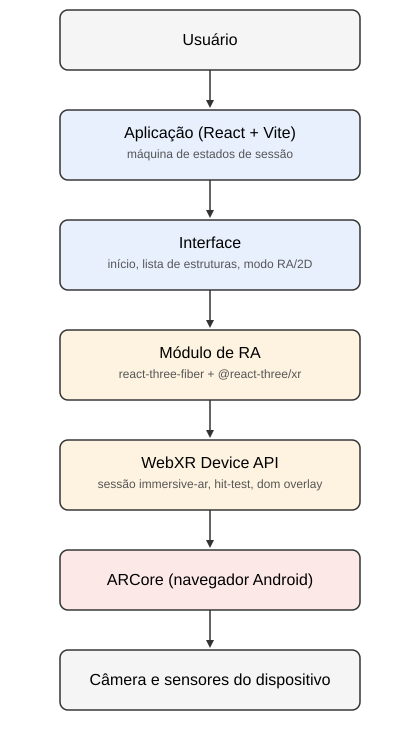

# Realidade Aumentada para Monumentos Histórico-Culturais

> Aplicação móvel de realidade aumentada que representa a escala e o processo construtivo do Coliseu, da Estátua da Liberdade e do Cristo Redentor, comparando seu efeito na compreensão desses aspectos com o de representações bidimensionais.


---

## 1. Identificação do Projeto

| Item            | Informação                                              |
| --------------- | ------------------------------------------------------- |
| **Projeto**     | Realidade Aumentada para Monumentos Histórico-Culturais |
| **Equipe**      | Conect Way                                              |
| **Curso**       | Engenharia de Computação                                |
| **Disciplina**  | UPx08 - Realidade Aumentada                             |
| **Professor**   | Daniel Ohata                                            |
| **Instituição** | Centro Universitário Facens, Sorocaba, SP               |
| **Semestre**    | 8º semestre, 2026                                       |

### Integrantes

| Nome                           | RA     | Responsabilidade técnica                                                                              |
| ------------------------------ | ------ | ----------------------------------------------------------------------------------------------------- |
| Bruno da Silveira Escanhoela   | 236793 | Pesquisa, licenciamento e otimização dos modelos 3D, validação de campo do rastreamento WebXR         |
| Gabriel Ferreira do Nascimento | 236085 | Configuração do projeto, implementação da ancoragem e do ajuste de escala do modelo, deploy na Vercel |
| João Guilherme Volta Kinol     | 235255 | Implementação dos instrumentos de avaliação (questionário SUS e questionário de compreensão)          |

---

## 2. Visão Geral

Recursos didáticos bidimensionais, como fotografias e ilustrações de livro didático, são amplamente utilizados no ensino de História, mas frequentemente falham em transmitir a magnitude física e a complexidade temporal de grandes monumentos histórico-culturais. Dados como altura e tempo de construção chegam ao estudante como números abstratos, sem referência corporal ou noção de esforço coletivo.

O público afetado por esse problema são estudantes do Ensino Fundamental, ao longo de diferentes anos do componente curricular de História, no estudo do patrimônio material como registro de sociedades passadas.

A solução proposta é uma aplicação móvel de realidade aumentada que posiciona modelos tridimensionais do Coliseu, da Estátua da Liberdade e do Cristo Redentor no ambiente físico do usuário, em escala reduzida (modo maquete), e apresenta o processo construtivo de cada estrutura como uma sequência de etapas navegáveis. A mesma aplicação também disponibiliza um modo bidimensional equivalente, usado como grupo de controle num estudo comparativo que avalia o efeito da representação em RA sobre a compreensão de escala e de processo construtivo.

A Realidade Aumentada participa da solução na camada central da aplicação: por meio da WebXR Device API, com detecção de superfícies (hit-test), o modelo tridimensional é ancorado sobre o ambiente capturado pela câmera do dispositivo, permitindo que o usuário o observe de diferentes posições e distâncias, ao contrário do que uma foto ou ilustração estática permite.

---

## 3. Problema

O ensino de patrimônio cultural material, ao tratar de monumentos históricos de grande porte, depende tradicionalmente de fotografias, ilustrações de livro didático e vídeos. Esses recursos comunicam bem a forma desses monumentos, mas dificilmente comunicam sua real magnitude: as dimensões físicas e a duração das obras chegam ao estudante como números abstratos, sem referência corporal nem noção do esforço coletivo envolvido em sua construção.

Essa dificuldade afeta estudantes do Ensino Fundamental brasileiro, no contexto do estudo de patrimônio cultural previsto na Base Nacional Comum Curricular. Sem uma forma de situar o monumento no próprio espaço do observador, o estudante tende a tratar sua escala e seu processo construtivo como fatos a memorizar, não como algo que pode ser compreendido espacialmente.

Esse problema existe porque nenhuma das soluções tradicionais isola o efeito da representação tridimensional sobre essa compreensão: a literatura da área trata a escala principalmente como restrição técnica, não como aspecto a ser diretamente comparado e medido.

---

## 4. Objetivos

### 4.1 Objetivo Geral

Desenvolver uma aplicação móvel de realidade aumentada que represente a escala e o processo construtivo de monumentos histórico-culturais, permitindo comparar seu efeito na compreensão desses aspectos com o de representações bidimensionais equivalentes.

### 4.2 Objetivos Técnicos

- implementar a ancoragem de modelos tridimensionais no ambiente físico via WebXR hit-test;
- permitir o ajuste da escala do modelo ancorado, em modo maquete, entre 1 e 4 metros;
- apresentar o processo construtivo de cada monumento como uma sequência de etapas navegáveis;
- implementar um modo bidimensional equivalente, destinado ao grupo de controle;
- implementar os instrumentos de avaliação (estimativa de dimensões, ordenação das etapas, questionário de compreensão e questionário de usabilidade SUS);
- disponibilizar a aplicação via navegador, acessível por HTTPS, sem necessidade de instalação;
- registrar e exportar os dados coletados em formato JSON e CSV.

---

## 5. Público-Alvo

O público-alvo descrito na pesquisa que motiva o projeto é o de estudantes do Ensino Fundamental, no contexto do ensino de patrimônio cultural material. Esse público não exige familiaridade técnica prévia: a aplicação foi pensada para rodar em smartphones Android comuns, sem necessidade de instalar nenhum aplicativo além do navegador.

Nesta etapa do projeto, por restrição de escopo (ausência de aprovação ética e de acesso formal a instituições de ensino básico), os testes e validações do protótipo são conduzidos com usuários proxy: colegas de curso recrutados por conveniência, não pertencentes à população-alvo original. Essa limitação está detalhada na seção 24 (Limitações Conhecidas).

---

## 6. Funcionalidades

| ID   | Funcionalidade                      | Descrição                                                                                                                          | Status |
| ---- | ----------------------------------- | ---------------------------------------------------------------------------------------------------------------------------------- | ------ |
| RF01 | Ancorar o modelo tridimensional     | Ancora o modelo da estrutura selecionada sobre um plano detectado no ambiente físico, via WebXR hit-test, em modo maquete          | ✅     |
| RF02 | Ajustar o tamanho do modelo         | Permite ajustar o tamanho do modelo ancorado entre 1 e 4 metros no maior eixo, calculado a partir da altura real de cada estrutura | ✅     |
| RF03 | Apresentar a estrutura da vez       | Apresenta cada estrutura (Coliseu, Estátua da Liberdade, Cristo Redentor) na ordem contrabalanceada definida pelo sistema          | ⬜     |
| RF04 | Navegar pelas etapas construtivas   | Permite avançar e retroceder entre as etapas do processo construtivo, mantendo o modelo ancorado                                   | ⬜     |
| RF05 | Exibir overlay informativo          | Exibe painel com texto e imagens de referência sobre a etapa construtiva em exibição                                               | ⬜     |
| RF06 | Apresentar modo bidimensional       | Apresenta, ao grupo de controle, o mesmo conteúdo em formato de imagem plana, sem o modelo 3D                                      | ⬜     |
| RF07 | Aplicar tarefa de estimativa        | Coleta a estimativa de dimensões e proporções de cada estrutura, antes e depois do uso                                             | ⬜     |
| RF08 | Aplicar tarefa de ordenação         | Apresenta as etapas construtivas embaralhadas para o participante reordenar                                                        | ⬜     |
| RF09 | Aplicar questionário de compreensão | Questionário de compreensão sobre o processo construtivo, em formato pré-teste e pós-teste                                         | 🚧     |
| RF10 | Aplicar questionário SUS            | Questionário de usabilidade (SUS), aplicado apenas ao grupo experimental                                                           | 🚧     |
| RF11 | Registrar e exportar dados          | Registra as respostas e interações da sessão, exportando em JSON e CSV                                                             | ⬜     |
| RF12 | Exibir figura humana de referência  | Exibe uma figura humana em escala real (1,70 m) ao lado do modelo ancorado, como referência visual de tamanho                      | ✅     |

**Legenda:** ✅ Implementado · 🚧 Em desenvolvimento · ⬜ Planejado · ❌ Cancelado

> RF09 e RF10 estão implementados como protótipos HTML isolados (`docs/index.html` e `docs/compreensao/index.html`), ainda não conectados ao fluxo principal da aplicação. A integração ao app React é o objetivo da task "Integrar instrumentos de avaliação ao fluxo do protótipo".

---

## 7. Requisitos Não Funcionais

| ID    | Categoria              | Requisito                                                                                                                     |
| ----- | ---------------------- | ----------------------------------------------------------------------------------------------------------------------------- |
| RNF01 | Plataforma             | A aplicação deve ser executada em navegador Android com suporte à WebXR Device API e ao ARCore, sem necessidade de instalação |
| RNF02 | Estabilidade           | O modelo ancorado deve permanecer fixo no plano detectado, sem deslocamento perceptível durante a sessão                      |
| RNF03 | Fidelidade dimensional | Os modelos devem preservar as proporções reais entre si em qualquer tamanho ajustado                                          |
| RNF04 | Desempenho             | Taxa mínima de 30 quadros por segundo e carregamento de cada modelo em até 10 segundos                                        |
| RNF05 | Ambiente               | Sessões em ambiente interno, com iluminação artificial uniforme e superfície horizontal texturizada                           |
| RNF06 | Usabilidade            | Usabilidade avaliada via System Usability Scale (SUS), com referência de 68 pontos                                            |
| RNF07 | Equivalência           | Os modos de RA e bidimensional devem rodar na mesma aplicação e dispositivo, com o mesmo conteúdo e tempo de exposição        |
| RNF08 | Disponibilidade        | Aplicação acessível via URL com HTTPS; dados armazenados localmente até a exportação                                          |
| RNF09 | Privacidade            | Participantes identificados apenas por código, sem dado pessoal identificável registrado                                      |

---

## 8. Tecnologias Utilizadas

| Tecnologia                                      | Versão  | Utilização                                                        |
| ----------------------------------------------- | ------- | ----------------------------------------------------------------- |
| React                                           | 19.2.8  | Biblioteca de interface                                           |
| react-three-fiber                               | 9.8.1   | Renderização 3D declarativa sobre Three.js                        |
| Three.js                                        | 0.186.1 | Motor de renderização 3D/WebGL                                    |
| @react-three/xr                                 | 6.6.31  | Integração com a WebXR Device API (hit-test, sessão immersive-ar) |
| @react-three/drei                               | 10.7.9  | Utilitários para react-three-fiber (carregamento de modelos glTF) |
| Tailwind CSS                                    | 4.3.3   | Estilização da interface                                          |
| Vite                                            | 6.4.3   | Build tool e servidor de desenvolvimento                          |
| TypeScript                                      | 6.0.2   | Tipagem estática                                                  |
| oxlint                                          | 1.81.0  | Linter                                                            |
| @gltf-transform (cli/core/extensions/functions) | 4.5.1   | Otimização dos modelos glTF (redução de polígonos)                |
| meshoptimizer                                   | 1.1.1   | Compressão de geometria dos modelos                               |
| sharp                                           | 0.35.5  | Compressão das texturas dos modelos                               |
| Vercel                                          | -       | Hospedagem e deploy contínuo, com HTTPS                           |
| GitHub                                          | -       | Controle de versão e hospedagem do repositório                    |

---

## 9. Hardware Utilizado

| Equipamento | Modelo             | Característica relevante                             | Utilização                                                |
| ----------- | ------------------ | ---------------------------------------------------- | --------------------------------------------------------- |
| Smartphone  | Samsung Galaxy S25 | Android, suporte à WebXR Device API e ao ARCore      | Validação completa em RA real                             |
| Computador  | Windows e Linux    | Google Chrome, com a extensão Immersive Web Emulator | Desenvolvimento e testes de interface, sem sessão RA real |

---

## 10. Arquitetura do Sistema



---

## 11. Funcionamento da Realidade Aumentada

A abordagem utilizada é markerless, por detecção de superfície (plane detection), via WebXR hit-test. Não há marcador, imagem de referência ou QR Code: o sistema reconhece qualquer plano horizontal detectado no ambiente capturado pela câmera.

Fluxo técnico:

Usuário escolhe a condição RA na tela de início → usuário toca em "Entrar em AR" → o navegador abre uma sessão WebXR `immersive-ar`, solicitando acesso à câmera → a cada quadro, `useXRHitTest` consulta o ARCore por planos detectados na direção em que o dispositivo aponta (`viewer`) → quando há um plano, um retículo (`Reticle`) é desenhado na posição detectada → o usuário toca na tela (evento `select` da sessão XR) → a posição do retículo no momento do toque é fixada como ponto de ancoragem → o modelo glTF da estrutura (via `useGLTF`) é instanciado nessa posição, em escala reduzida (modo maquete) → o usuário ajusta o tamanho pelo controle deslizante, renderizado como um `XRDomOverlay` sobre a cena → o usuário conclui a estrutura e o fluxo avança para a próxima.

---

## 12. Estrutura do Projeto

```
app/
├── public/
│   └── models/          glBs otimizados (coliseu, estátua, cristo, humano)
├── scripts/
│   └── optimize-models.mjs   script de otimização dos modelos 3D
├── src/
│   ├── App.tsx           telas e máquina de estados da sessão (início, lista, RA, 2D)
│   ├── structures.tsx     dados e componentes dos modelos 3D
│   ├── counterbalance.ts  ordem contrabalanceada das estruturas por sessão
│   ├── main.tsx           ponto de entrada da aplicação
│   └── index.css          estilos globais (Tailwind)
docs/
├── index.html             protótipo do questionário SUS
├── compreensao/           protótipo do questionário de compreensão
├── estimativa/            protótipo da tarefa de estimativa de escala
├── documents/             documentação de licenças e otimização dos modelos
└── diagrams/              diagramas do projeto (arquitetura)
README.md                  esta documentação
```

Os protótipos em `docs/` ainda são HTML isolados, não conectados ao fluxo principal em `app/src` (ver seção 6, RF09-RF11).

---

## 13. Principais Scripts ou Componentes

| Arquivo               | Responsabilidade                                                                                  |
| --------------------- | ------------------------------------------------------------------------------------------------- |
| `App.tsx`             | Telas e máquina de estados da sessão (início, lista de estruturas, modo RA, modo 2D, conclusão)   |
| `structures.tsx`      | Dados (dimensões reais) e componentes de carregamento dos modelos 3D (`Structure`, `HumanFigure`) |
| `counterbalance.ts`   | Define a ordem contrabalanceada das estruturas, cíclica por sessão via `localStorage`             |
| `main.tsx`            | Ponto de entrada da aplicação React                                                               |
| `optimize-models.mjs` | Script Node, fora do app, usado pra reduzir polígonos e comprimir texturas dos modelos glTF       |

Dentro de `App.tsx`, os componentes internos mais relevantes:

| Componente      | Responsabilidade                                                                 |
| --------------- | -------------------------------------------------------------------------------- |
| `StartScreen`   | Captura o código do participante e a condição experimental (RA ou Bidimensional) |
| `StructureList` | Mostra a estrutura da vez, na ordem contrabalanceada                             |
| `Reticle`       | Desenha o indicador de plano detectado via WebXR hit-test                        |
| `AnchoredModel` | Renderiza a estrutura e a figura humana de referência na posição ancorada        |
| `SizeControl`   | Controle deslizante de tamanho do modelo, renderizado como `XRDomOverlay`        |
| `FlatView`      | Tela do modo bidimensional, com a imagem estática da estrutura                   |
| `FpsMeter`      | Mede a taxa de quadros por segundo (ativado via `?fps` na URL, suporte ao RNF04) |

---

## 14. Dependências

```
react ^19.2.8
react-dom ^19.2.8
@react-three/fiber ^9.8.1
@react-three/xr ^6.6.31
@react-three/drei ^10.7.9
three ^0.186.1
tailwindcss ^4.3.3
@tailwindcss/vite ^4.3.3
@gltf-transform/cli 4.5.1
@gltf-transform/core 4.5.1
@gltf-transform/extensions 4.5.1
@gltf-transform/functions 4.5.1
meshoptimizer 1.1.1
sharp 0.35.5
vite ^6.4.3
typescript ~6.0.2
oxlint ^1.81.0
```

Todas disponíveis via npm, listadas em `app/package.json`.

---

## 15. Configuração do Ambiente

1. Instalar o [Node.js](https://nodejs.org/) (testado com a versão 22).
2. Clonar o repositório.
3. Entrar na pasta `app/`.
4. Instalar as dependências com `npm install`.

Nenhuma variável de ambiente é necessária: o projeto não usa chave de API nem backend próprio.

---

## 16. Como Executar o Projeto

Dentro da pasta `app/`:

```
npm run dev
```

Inicia o servidor de desenvolvimento (Vite). Abre o endereço mostrado no terminal em um navegador com suporte à WebXR Device API (Chrome no Android, ou Chrome/Edge no desktop com a extensão Immersive Web Emulator para simular uma sessão AR).

```
npm run build
```

Gera a build de produção em `app/dist`, com verificação de tipos (`tsc -b`) antes do build.

```
npm run lint
```

Executa o linter (`oxlint`) sobre o código fonte.

```
npm run models
```

Roda o script de otimização dos modelos 3D (`scripts/optimize-models.mjs`), a partir dos modelos originais em `models-src/` (não versionado).
